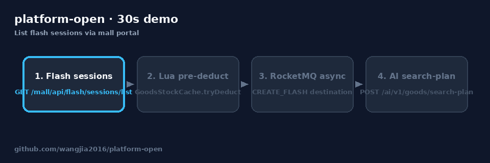
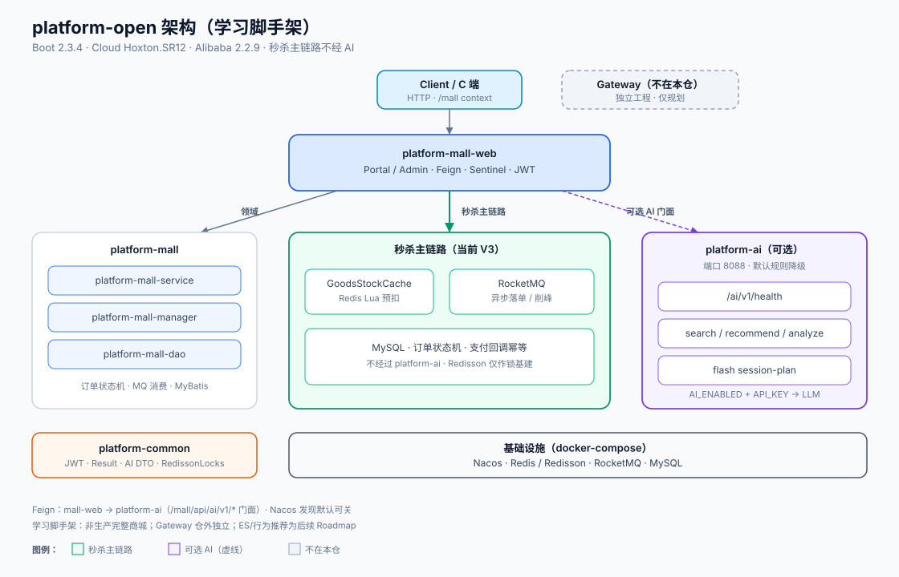
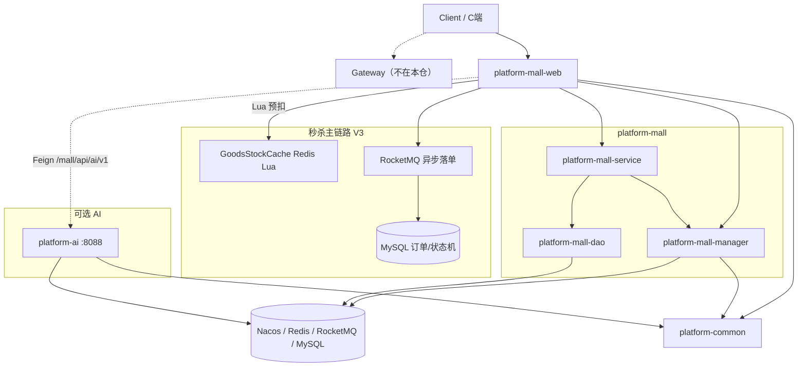
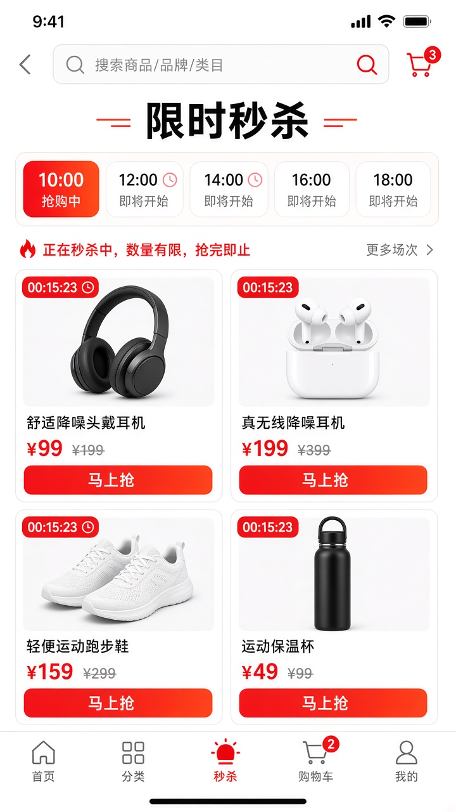
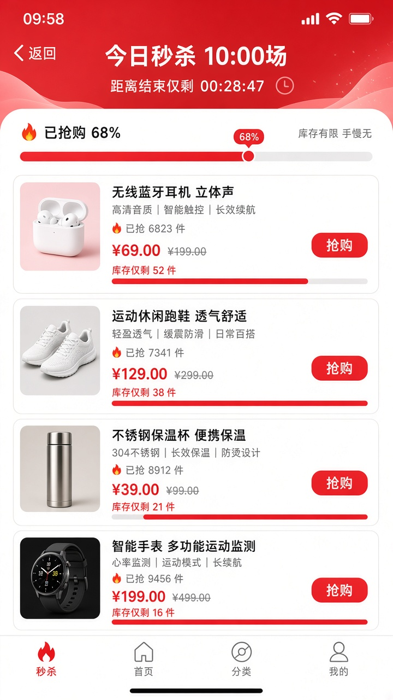
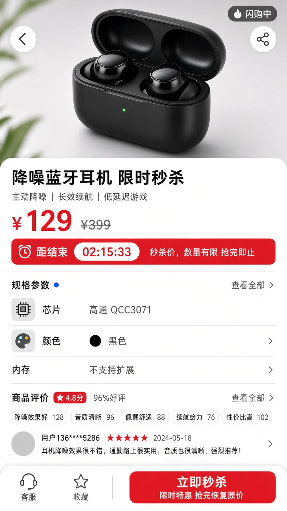
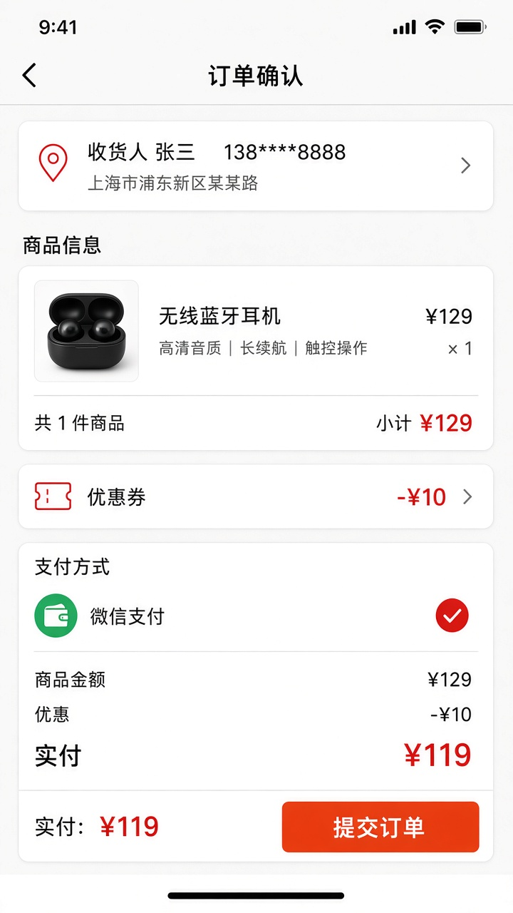
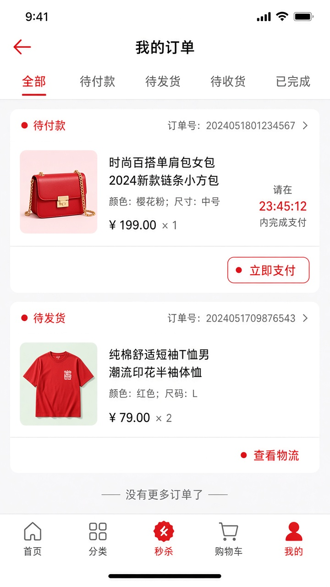

# platform-open

**基于 Spring Cloud Alibaba 的微服务实践工程**（商城 / 秒杀）。核心链路（库存防超卖、MQ 削峰、支付幂等、订单状态机等）来自已上线业务的沉淀与开源整理；本仓面向可运行、可阅读的完整示例，版本钉在 Boot 2.3 / Hoxton，不追逐最新发行版。

**社区与安全：** [贡献指南](CONTRIBUTING.md) · [安全披露](SECURITY.md) · [学习路径](docs/LEARNING_PATH.md) · [架构说明](docs/ARCHITECTURE.md) · [Roadmap](docs/ROADMAP.md) · [Changelog](CHANGELOG.md) · License: Apache-2.0

[](https://github.com/wangjia2016/platform-open/actions/workflows/ci.yml) [](./LICENSE) [](./pom.xml) [](./pom.xml)


## 30 秒演示（curl）

依赖已 `docker compose up -d` 且 `platform-mall-web` 已启动（详见 [QUICKSTART.md](./QUICKSTART.md)）。

```bash
# 1) 秒杀场次列表
curl -sS "http://127.0.0.1:8080/mall/api/flash/sessions/list" | head -c 300; echo

# 2) AI 健康检查 + 搜索计划（需另起 platform-ai；无密钥=规则降级）
curl -sS http://127.0.0.1:8088/ai/v1/health; echo
curl -sS -X POST http://127.0.0.1:8088/ai/v1/goods/search-plan \
  -H 'Content-Type: application/json' \
  -d '{"query":"300元内降噪耳机"}'; echo
```

AI 请求/响应样例：[`docs/ai/examples/`](./docs/ai/examples/)。失败分支对照：[`docs/ARCHITECTURE.md` §失败路径](./docs/ARCHITECTURE.md#秒杀主链路失败路径)。

流程示意：



静态版：[demo-flow.svg](docs/screenshots/demo-flow.svg)。

## 和其他常见秒杀 Demo 比什么

| 能力 | 本仓 | 常见教程 Demo |
| --- | --- | --- |
| 库存防超卖 | Redis Lua 原子预扣（`GoodsStockCache`） | 多为止于 DB 锁 / 单机锁示意 |
| 削峰 | RocketMQ 异步落单 + 发送失败回补 | 常同步写库 |
| 支付 | 回调乐观锁幂等 + 单测 | 常省略 |
| 订单 | 状态机 | 常单表状态字段 |
| AI | `platform-ai`：搜索计划 / 推荐 / 分析 / 场次策划，热路径不经 AI | 少见 |
| 可运行性 | docker-compose + QUICKSTART curl | 参差 |

## 适合谁 / 边界说明

| 适合 | 本仓刻意不做 / 不在本仓 |
| --- | --- |
| 对照真实秒杀链路做二次开发或研读（Lua 库存、MQ 削峰、支付幂等、状态机） | 完整 C 端 App、独立 Gateway 工程（Gateway 另仓） |
| 本地 `docker-compose` 一键拉起依赖并跑通 [QUICKSTART](./QUICKSTART.md) | 多机生产部署手册、压测环境一键交付 |
| 按 [学习路径](docs/LEARNING_PATH.md) / [架构说明](docs/ARCHITECTURE.md) 深入模块 | Boot 3 / 最新 Alibaba 版本追随 |

**5 分钟上手：** 见 [QUICKSTART.md](./QUICKSTART.md)（`docker compose up -d` → 启动 `platform-mall-web`）。

### AI 辅助（商城场景）

- **第一期（文档）：** [docs/ai/README.md](docs/ai/README.md) — Agent / Skills / 提示词
- **架构与是否独立服务：** [docs/ai/ARCHITECTURE.md](docs/ai/ARCHITECTURE.md) — 结论为仓内独立模块 `platform-ai`，mall Feign 调用；秒杀主链路不经过 AI
- **第二期（已落地）：** 模块 `platform-ai`（8088）+ 门面 `/mall/api/ai/v1/*`；默认规则降级，`AI_ENABLED`+`AI_API_KEY` 后走模型

## 1. 项目说明

- 技术基线：Spring Boot **2.3.4**、Spring Cloud **Hoxton.SR12**、Spring Cloud Alibaba **2.2.9.RELEASE**（以根目录 `pom.xml` 为准）
- 整合组件：Nacos、RocketMQ、Sentinel、Feign、Redis、Redisson、JJWT、MyBatis 等
- 业务示例：秒杀、优惠券、微信支付、商品配置、订单（完整度以代码为准；网关为独立工程，不在本仓）
- 秒杀当前路径：Redis Lua 原子预扣可售库存（`GoodsStockCache`）+ RocketMQ 异步落单；Redisson 作锁基础设施（解锁请走 `RedissonLocks.safeUnlock`）
- 另有：基于 Redis 的幂等、全局统一异常、常见设计模式落点（工厂 / 策略 / 模板方法 / 状态机等）

### 主要版本（摘自根 `pom.xml` / 子模块）

| 组件 | 版本 |
| --- | --- |
| Spring Boot | 2.3.4.RELEASE |
| Spring Cloud | Hoxton.SR12 |
| Spring Cloud Alibaba | 2.2.9.RELEASE |
| Java | 1.8 |
| MyBatis-Plus | 3.4.0 |
| rocketmq-spring-boot-starter | 2.0.3 |
| Redisson | 3.17.7 |
| JJWT | 0.10.7 |
| Guava | 32.1.3-jre |
| springfox (Swagger) | 3.0.0 |
| MapStruct | 1.3.1.Final |
| Lombok | 1.18.8 |
| Jedis | 3.3.0 |

说明：若文中仍出现「RocketMQ 4.7.1」等，多指常见 Broker/运维侧版本；本仓 Maven 依赖以表内为准。

### 模块一览

| 模块 | 作用 |
| --- | --- |
| `platform-common` | JWT、锁工具、公共异常与基础能力 |
| `platform-mall-web` | HTTP 入口（portal / admin） |
| `platform-mall-service` | 领域服务、状态机、MQ 消费等 |
| `platform-mall-manager` | 缓存与外部资源封装（含 `GoodsStockCache`） |
| `platform-mall-dao` | MyBatis 实体 / Mapper / SQL |
| `platform-starter` | 启动与基础装配 |

更细的依赖关系与秒杀时序见 [docs/ARCHITECTURE.md](docs/ARCHITECTURE.md)。

## 2.秒杀介绍
- 秒杀的难点
  - 瞬时流量
  - 防止库存超卖
  - 吞吐量
- 流量预估
  - 如何预估秒杀峰值？
  - 每个订单对象大小估算？
  - 带宽估算？
- 优化
  - 秒杀下 JVM 如何优化
  - 如何快速定位线上问题
  - 如何压测？
  
## 3.秒杀架构演变
- V1.0 单机：数据库悲观锁 / 乐观锁，或 `ReentrantLock` / `synchronized`
- V2.0 分布式：曾用 Redisson 分布式锁控库存（易在租约过期后误 unlock，已弃用该路径）
- V3.0（当前）：Redis Lua 预扣可售库存 + RocketMQ 异步落单，多级缓存与削峰

## 4.秒杀解决方案  
- 业务尽可能简单，能取缓存就从缓存取（可以是多级缓存），减轻 mysql 的压力
- 采用 mq 异步，削峰，控制入库的数量
- 流量拦截，尽可能将请求拦截在上游，比如参数校验，黑名单校验等业务校验
- 前端
  - 秒杀倒计时（甚至有部分电商，各用户看到的倒计时都不一样）
  - 页面静态化
  - 防止重复点击
  - 隐藏 url
- 网关拦截
  - 校验 token 
  - 接口防刷 （防黄牛 - 风控机制）
  - 幂等性校验

## 5. 项目架构图

原 CDN 外链图已失效；下方为按当前代码重绘的架构图（含可选 `platform-ai`，秒杀主链路不经过 AI）。



更细的模块依赖与秒杀时序见 [docs/ARCHITECTURE.md](docs/ARCHITECTURE.md)。GitHub 也可直接渲染下方 Mermaid：



## 6. 技术栈
- Spring Cloud Hoxton.SR12
- Spring Cloud Alibaba 2.2.9.RELEASE
- Nacos
- OpenFeign
- Ribbon
- Redis
- Redisson
- RocketMQ（spring-boot-starter 2.0.3）
- Sentinel
- ElasticSearch（规划/周边能力，本仓未必完整包含）
- Spring Cloud Gateway（独立仓库）
- JWT
- MyBatis
- MyBatis-Plus 3.4.0
- Jackson
- HikariCP
- Kaptcha
- Swagger (springfox 3.0.0)

## 7. 工程结构
  基于 Maven 的多 module 模块，如果要加入其它微服务模块，直接添加即可

## 8. 秒杀业务时序图
   参数校验 --> redis 库存预扣减 --> 发送下单消息到 MQ --> 提示订单处理中
   订阅者 --> 拉取下单消息 --> 真实库存扣减…&下单入库

## 9. 业务功能模块
- 秒杀业务
  - 秒杀场次列表（门户 `GET /api/flash/sessions/list`）
  - 秒杀活动，一个活动包含秒杀起止时间、活动名称等（表 `mall_flash_promotion`）
  - 秒杀场次，一个场次包含多个秒杀商品（门户 `GET /api/flash/sessions/goods`；管理端绑定 `POST /admin/flash/sessions/bindGoods`）
  - 秒杀商品，一个秒杀商品可以被多个秒杀场次关联（表 `mall_flash_sessions_goods`）
- 支付
- 通知
  - 待支付提醒
  - 订单取消提醒
  - 支付提醒
  - 发货提醒
- 支付回调
- 订单状态机 - 状态模式实现

## 10.系统流程

## 11.开发者规约
- 参考 阿里巴巴 Java 开发者规范《Java 开发手册》嵩山版

## 12.压测结果
    使用 JMeter 进行压测

## 13.部署说明
  先导入数据库脚本（目录 `platform-mall/platform-mall-dao/src/main/resources/sql/`）：
  1. `mall_flash.sql` — 秒杀活动 / 场次 / 场次商品表结构
  2. `thread_pool_config.sql` — 线程池配置表 + `order_pool` / `goods_pool` 种子
  3. `mall_flash_seed.sql` — 演示用进行中的秒杀场次（默认绑定 `mall_goods.id = 1`，可改脚本里的 `@demo_goods_id`）
  4. `mall_cart.sql` — 购物车等（可选；完整商城还需自备 `mall_goods` 等业务表数据）
  敏感配置已改为环境变量占位（见根目录 `.env.example`），请勿把真实密码提交进仓库
  - 常用变量：`MYSQL_PASSWORD`、`REDIS_PASSWORD`、`JWT_SECRET`（以及可选的 `MYSQL_URL`、`NACOS_ADDR`、`ROCKETMQ_NAME_SERVER`）
  - 本地也可复制 `application-local.yml.example` → `application-local.yml`（已 gitignore），用 `--spring.profiles.include=common,local` 覆盖
  - 参考：`platform-mall/.../application-example.yml`
  启动相应的组件（MySQL / Redis / Nacos / RocketMQ）
  - 一键本地依赖：`docker compose up -d`（见根目录 `docker-compose.yml`）
  - 步骤说明：[QUICKSTART.md](./QUICKSTART.md)


## 14.许可协议
本项目采用 [Apache License 2.0](./LICENSE) 开源协议。

Copyright 2020-2026 wangjia2016

你可以自由地使用、修改和分发本项目代码，但须保留版权与许可声明；详见仓库根目录 `LICENSE`。

## 15.功能截图

以下为 **C 端示意稿**（参考主流电商 App 的信息架构与交互节奏，原创 UI，非真实线上页面截图；本仓库目前主要是后端/秒杀能力，前端仅为说明用）。

| 页面 | 说明 |
| --- | --- |
| 首页 | 搜索、超级秒杀入口、限时秒杀横滑、猜你喜欢 |
| 秒杀场次 | 多场次 Tab（抢购中 / 即将开始）+ 双列商品 |
| 场次商品列表 | 单场倒计时、已抢进度、库存条、抢购按钮 |
| 商品详情 | 秒杀价、倒计时、规格、评价、立即秒杀 |
| 确认订单 | 地址、优惠券、支付方式、提交订单 |
| 我的订单 | 待付款 / 待发货等状态与操作 |

### 首页


### 秒杀场次


### 场次商品列表


### 商品详情（秒杀）


### 确认订单


### 我的订单


