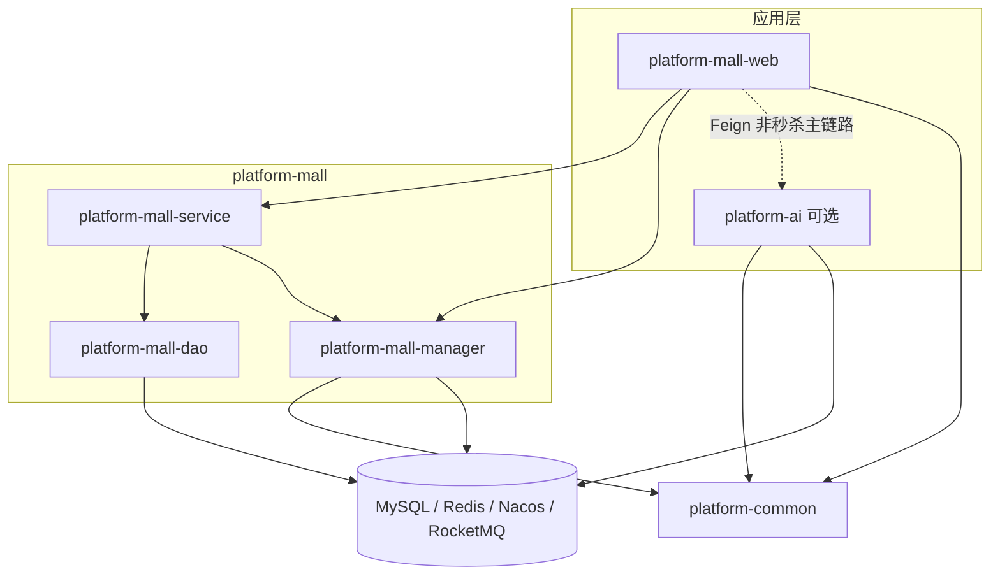
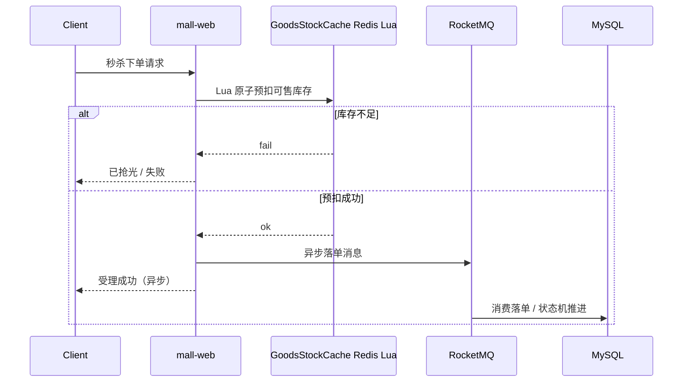

# 架构与模块地图

面向把本仓库当 **Spring Cloud Alibaba 学习脚手架** 的读者：先看清边界，再顺着秒杀主链路读代码。

## 仓库边界（诚实说明）

| 在本仓 | 不在本仓 / 仅规划 |
| --- | --- |
| `platform-common` 公共组件（JWT、Redisson 安全解锁、异常等） | 独立 Gateway 工程 |
| `platform-mall` 商城/秒杀示例（web / service / dao / manager） | 完整前台 App（README 截图为示意稿） |
| `platform-starter` 启动相关脚手架能力 | Elasticsearch 等周边能力未必齐备 |
| `platform-ai` 可选 AI 辅助（默认规则降级） | 完整推荐中台 / 行为协同过滤 |
| `docker-compose` 本地 MySQL / Redis / Nacos / RocketMQ | 生产级多机部署与压测环境 |

版本钉在根 `pom.xml`（当前 Boot 2.3.4 / Cloud Hoxton.SR12 / Alibaba 2.2.9），**不是**跟踪各组件最新发行版。

## 模块依赖（简图）

完整配图见 [../screenshots/architecture.svg](./screenshots/architecture.svg)；下图为可渲染源：

## 秒杀主链路（当前实现）

关键入口（建议按此顺序阅读）：

1. Portal：`MallFlashPortalController`（`api/flash`）
2. 库存：`GoodsStockCache`（Redis Lua 预扣）
3. 锁工具：`RedissonLocks.safeUnlock`（勿在租约过期后误 unlock）
4. 订单状态机与支付回调幂等：`platform-mall-service` / 相关单测

## 设计模式落点（示例，非穷尽）

- **状态机**：订单状态流转（含单测回归）
- **策略 / 工厂**：支付、优惠等可扩展点（以代码为准）
- **模板方法**：公共处理骨架（见 common / service 层既有写法）

更细的「学什么、按什么顺序学」见 [LEARNING_PATH.md](./LEARNING_PATH.md)。
