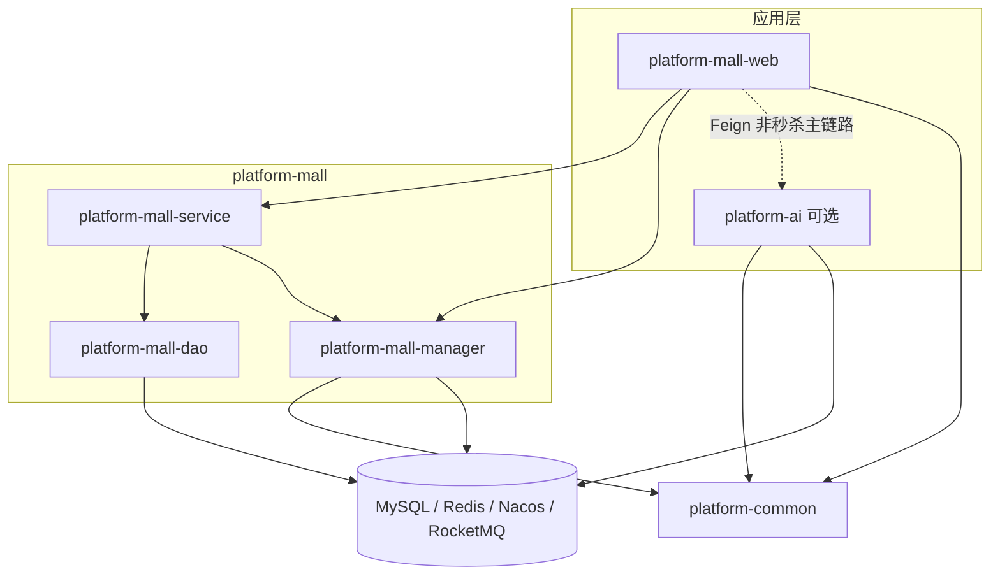
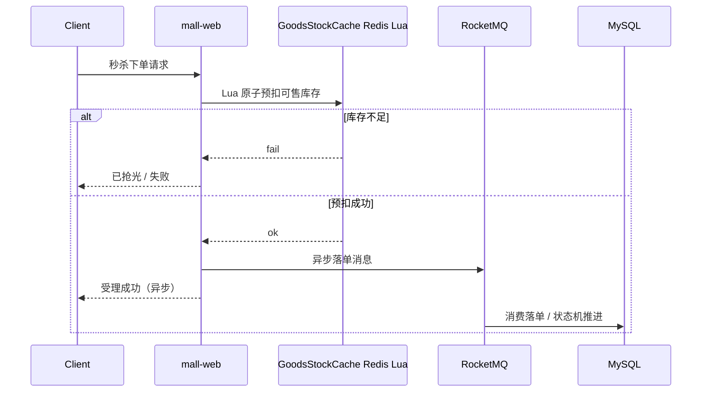

# 架构与模块地图

面向研读或二次开发本仓的读者：先看清边界，再顺着秒杀主链路读代码。核心实现来自生产实践的开源整理。

## 仓库边界（诚实说明）

| 在本仓 | 不在本仓 / 仅规划 |
| --- | --- |
| `platform-common` 公共组件（JWT、Redisson 安全解锁、异常等） | 独立 Gateway 工程 |
| `platform-mall` 商城/秒杀示例（web / service / dao / manager） | 完整前台 App（README 截图为示意稿） |
| `platform-starter` 启动与基础装配 | Elasticsearch 等周边能力未必齐备 |
| `platform-ai` 可选 AI 辅助（默认规则降级） | 完整推荐中台 / 行为协同过滤 |
| `docker-compose` 本地 MySQL / Redis / Nacos / RocketMQ | 生产级多机部署与压测环境 |

版本钉在根 `pom.xml`（当前 Boot 2.3.4 / Cloud Hoxton.SR12 / Alibaba 2.2.9），**不是**跟踪各组件最新发行版。

## 模块依赖（简图）

完整配图见 [../screenshots/architecture.svg](./screenshots/architecture.svg)；下图为可渲染源：

## 秒杀主链路（当前实现）

关键入口（建议按此顺序阅读）：

1. Portal：`MallFlashPortalController`（`api/flash`）
2. 库存：`GoodsStockCache`（Redis Lua 预扣）
3. 锁工具：`RedissonLocks.safeUnlock`（勿在租约过期后误 unlock）
4. 订单状态机与支付回调幂等：`platform-mall-service` / 相关单测

## 秒杀主链路失败路径

对照代码阅读时优先看这些分支（对应 Issue [#9](https://github.com/wangjia2016/platform-open/issues/9)）。

### 1. Redis Lua 预扣库存不足 / 异常

入口：`MallOrderServiceImpl.preReduceStock` → `deductOrSeed` → `GoodsStockCache.tryDeduct`。

| Lua / 返回值 | 含义 | 调用方行为 |
| --- | --- | --- |
| `>= 0` | 预扣成功，值为扣减后剩余 | 继续发秒杀创建订单 MQ |
| `-1` | 库存不足 | 抛 `InsufficientStockException`（对外多为已抢光/库存不足） |
| `-2` | 键不存在或非整数 | 先 `getMallGoods` 回源种缓存再扣一次；仍失败则 `BusinessException` |
| `-3` | 扣减数量非法（`num<=0`） | 视为预扣失败 → `BusinessException` |

Lua 脚本见 `GoodsStockCache.DEDUCT_LUA`。单测约定与 `GoodsStockCache.apply` 对齐。

### 2. MQ 发送 / 消费失败与补偿边界

**发送（预扣之后）** — `MallOrderServiceImpl.preReduceStock`：

1. Lua 预扣成功后 `syncSend` 到 `MallOrderMq.CREATE_FLASH_DESTINATION`  
2. `SendStatus != SEND_OK` → `goodsStockCache.restore` 回补缓存，方法返回 `false`  
3. 发送抛异常 → `restore` + 抛 `BusinessException("下单消息发送失败")`  

**消费** — `CreateOrderMessageHandler.onMessage`：

1. 消息缺 `orderId` → `BusinessException`（交由 RocketMQ 重试策略）  
2. 订单已存在 → 打日志后直接 return（消费幂等）  
3. `createOrder` 抛 `InsufficientStockException` → **`restore` 回补预扣**并吞掉该异常（确认消息，避免死循环重试空扣）  
4. 其它创建失败 → 抛异常，交给 RocketMQ 重试  

**取消订单回补** — `cancel` 路径：DB `updateGoodStockBack`；缓存经 `restoreCacheAfterCommit`（事务提交后 `GoodsStockCache.restore`）。DB 回补行数为 0 时只打 warn，不二次瞎加缓存。

边界说明：本仓补偿以「缓存回补 + MQ 重试」为主，**没有**独立的跨天对账任务；生产环境通常还要补对账。

### 3. 支付回调重复通知（幂等）

入口：`MallOrderPayPortalController.notifyOrderProcess` → `MallOrderPayServiceImpl.notifyOrderProcess`。  
回归：`MallOrderPayNotifyTest`。

| 情况 | 行为 |
| --- | --- |
| `outTradeNo` 非数字 | 返回 `false`，打 error |
| 订单不存在 | 返回 `false` |
| 状态已不是待支付 | 视为重复/已处理，返回 `true`（向渠道应答成功，避免无限重试） |
| 乐观锁 `update ... where order_status=待支付` 影响行 0 | 并发重复，返回 `true` |
| 首次更新成功 | 置为待发货等字段，并 `asyncMsgProcess` 发支付成功 MQ（KEYS=订单号便于下游去重） |

订单状态机其它流转见 `platform-mall-service` 状态机实现与单测；支付回调只负责「待支付 → 已支付/待发货」这一跳的幂等。

### 4. 建议阅读顺序

1. `GoodsStockCache`  
2. `MallOrderServiceImpl.preReduceStock` / `CreateOrderMessageHandler`  
3. `MallOrderPayServiceImpl.notifyOrderProcess` + `MallOrderPayNotifyTest`  
4. `RedissonLocks.safeUnlock`（锁基建，勿在租约过期后误 unlock）

## 设计模式落点（示例，非穷尽）

- **状态机**：订单状态流转（含单测回归）
- **策略 / 工厂**：支付、优惠等可扩展点（以代码为准）
- **模板方法**：公共处理骨架（见 common / service 层既有写法）

更细的「学什么、按什么顺序学」见 [LEARNING_PATH.md](./LEARNING_PATH.md)。
