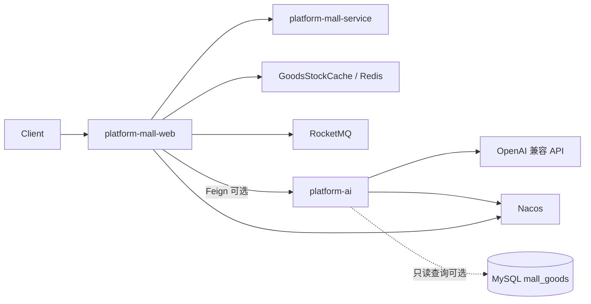
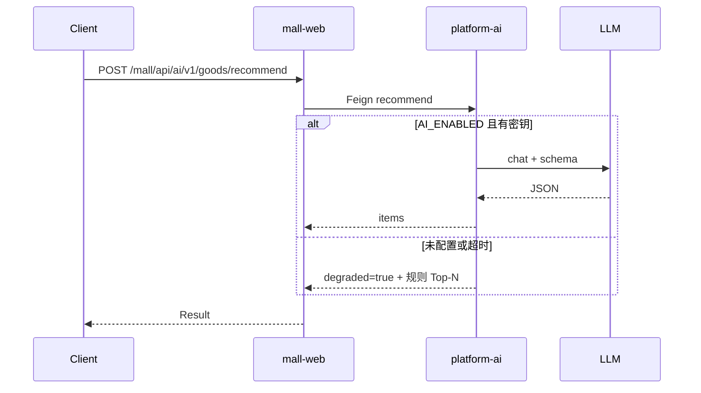

# AI 技术设计与架构（第一期定稿 / 第二期实施）

> **第二期实施状态（本仓）：** 已落地模块 `platform-ai` + mall Feign 门面 `/mall/api/ai/v1/*`；默认 `AI_ENABLED=false`，走规则降级。

## 1. 要解决什么

在 **不夸大成完整推荐中台** 的前提下，为学习脚手架补上可演示、可扩展的 AI 能力：

1. **商品搜索计划**：自然语言 → 结构化检索意图 / 过滤 / 排序（本仓暂无 ES，先出「查询计划」）  
2. **商品推荐**：锚点商品 + 候选集 → Top-N + 理由 + 降级策略  
3. **商品分析**：单品/批量 → 卖点、定价与库存风险、文案草稿  
4. （延伸）**秒杀场次策划**：活动窗口 + 商品池 → 场次方案（贴合本仓强项）

## 2. AI 要不要单独服务？——结论

### 结论：**单独成服务（本仓内新模块），mall 通过 Feign 调用**

| 方案 | 做法 | 优点 | 缺点 | 结论 |
| --- | --- | --- | --- | --- |
| A. 嵌在 `platform-mall-web` | Controller + 本地调用 LLM | 实现快、少一个进程 | 密钥/超时/依赖污染商城主链路；不利于演示微服务边界 | 仅作本地调试兜底，**不是目标形态** |
| B. **独立 `platform-ai` 服务** | 独立 Boot 应用 + Nacos；mall-web Feign | 与脚手架叙事一致；可单独扩缩容/降级；密钥与模型依赖隔离 | 多一个进程与配置 | **采用** |
| C. 仓外独立仓库 | 另一个 Git 仓 | 边界最清 | 学习脚手架碎片化，不利于一键 docker-compose | 不做 |

**采用 B**：第二期在本仓新增模块（建议名 `platform-ai`，包名 `com.platform.ai`），注册到现有 Nacos；`platform-mall-web`（或 `platform-mall-manager`）经 **OpenFeign** 调用。AI 挂了或未配置密钥时，mall **降级**（规则推荐 / 返回明确错误码），不影响秒杀主链路。



要点：

- **秒杀下单、库存 Lua、支付回调不经过 AI**（防超卖与幂等路径保持纯确定性）。  
- AI 只服务「读多写少」的辅助接口；写库（改价、上下架）第二期默认 **不做**，只出建议。  
- `platform-ai` **可以**只读查商品表或吃调用方传入的商品 JSON；优先 **调用方传快照**，减少 AI 服务对 mall 库的耦合。

## 3. 模块与包结构（第二期目标）

```text
platform-ai/
  pom.xml
  src/main/java/com/platform/ai/
    PlatformAiApplication.java
    config/          # 模型客户端、超时、开关
    web/             # HTTP：/ai/v1/...
    application/     # 用例：SearchPlan / Recommend / Analyze
    llm/             # Prompt 装载 + ChatClient + JSON 解析校验
    fallback/        # 无密钥 / 超时：规则引擎降级
  src/main/resources/
    application.yml
    prompts/         # 可从 docs/ai/prompts 同步或运行时 classpath 拷贝
```

mall 侧：

```text
platform-mall-web/.../ai/MallAiPortalController.java   # 门面，转发 Feign
platform-mall-manager/.../ai/PlatformAiClient.java     # Feign
```

本地：`docker-compose` **不强制**起 LLM；`platform-ai` 可与 mall 一同起，未配 `AI_API_KEY` 时走 fallback。

## 4. 接口契约（第二期）

统一前缀（AI 服务直连）：`/ai/v1`  
经 mall 门面（可选）：`/mall/api/ai/v1`（context-path `/mall`）

| 方法 | 路径 | 说明 |
| --- | --- | --- |
| POST | `/ai/v1/goods/search-plan` | 自然语言 → 搜索计划 |
| POST | `/ai/v1/goods/recommend` | 推荐 Top-N |
| POST | `/ai/v1/goods/analyze` | 商品分析报告 |
| GET  | `/mall/api/ai/v1/goods/analyze-by-id?goodsId=` | mall 门面：库内商品 → 快照 → analyze（只读） |
| GET  | `/mall/api/ai/v1/goods/recommend-by-anchor?goodsId=` | mall 门面：锚点 + 在售候选 → recommend（只读） |
| POST | `/ai/v1/flash/session-plan` | 秒杀场次策划（延伸） |
| GET  | `/ai/v1/health` | 含 `llmConfigured=true|false` |

### 4.1 search-plan 请求/响应（草案）

```json
// request
{ "query": "300 元内降噪耳机", "locale": "zh-CN", "hints": { "maxPrice": 300 } }

// response
{
  "intent": "寻找价位<=300的降噪耳机",
  "filters": [{ "field": "price", "op": "lte", "value": 300 }, { "field": "onUnSale", "op": "eq", "value": 0 }],
  "sort": [{ "field": "price", "order": "asc" }],
  "keywords": ["降噪", "耳机"],
  "pseudoSql": "SELECT ... FROM mall_goods WHERE ...",
  "notes": ["本仓未接 ES：请用 MyBatis 条件或后续 ES 实现"]
}
```

### 4.2 recommend 请求/响应（草案）

```json
// request
{
  "anchorGoodsId": 1,
  "candidates": [ { "id": 2, "name": "...", "price": 99.0, "stock": 10 } ],
  "limit": 5,
  "context": { "scene": "flash", "sessionsId": 1 }
}

// response
{
  "items": [{ "goodsId": 2, "score": 0.82, "reasons": ["同价带", "有库存"] }],
  "strategy": "llm_rerank_or_rules",
  "degraded": false
}
```

### 4.3 analyze 请求/响应（草案）

```json
// request
{ "goods": { "id": 1, "name": "...", "price": 199, "stock": 5, "stockWarn": 10, "onUnSale": 0 } }

// response
{
  "summary": "...",
  "sellingPoints": ["..."],
  "risks": ["库存低于预警"],
  "copyDrafts": { "title": "...", "subtitle": "..." },
  "pricingNotes": "..."
}
```

错误码约定（与现有 `Result` 可对齐）：`AI_NOT_CONFIGURED` / `AI_TIMEOUT` / `AI_BAD_OUTPUT` / `AI_DEGRADED`。

## 5. 提示词与 Skills 如何进运行时

- **第一期**：人读 `docs/ai/prompts/*`、`skills/*`。  
- **第二期**：构建时把 `docs/ai/prompts` **复制或 submodule 式同步**到 `platform-ai` classpath（避免两套漂移）；Skill 文档仍给人用，运行时只吃 prompts + JSON schema。  
- 输出必须 **JSON schema 校验**；失败则降级或返回 `AI_BAD_OUTPUT`，禁止把模型胡话当价/库存写库。

## 6. 配置与安全

| 变量 | 用途 |
| --- | --- |
| `AI_API_KEY` | 模型密钥（仅环境变量 / 本地 yml，不进 Git） |
| `AI_BASE_URL` | OpenAI 兼容端点 |
| `AI_MODEL` | 模型名 |
| `AI_ENABLED` | 总开关，默认 `false` 直到显式打开 |
| `AI_TIMEOUT_MS` | 调用超时（建议 ≤ 8s，Feign 更短） |

禁止：把密钥写进 examples；AI 服务日志打印完整密钥；用 AI 结果直接改库存/支付状态。

## 7. 降级与一致性



秒杀主链路（Lua → MQ → DB）**零依赖** AI。

## 8. 第二期实施清单（「全部落地」含义）

按本设计一次性落地，而不是只做文档：

1. 新建 Maven 模块 `platform-ai` + 启动类 + Nacos 注册  
2. 实现 §4 四个业务 API + health（session-plan 可同 PR）  
3. Prompt 装载、schema 校验、fallback 规则推荐  
4. mall-web Feign 门面 `/mall/api/ai/v1/*`  
5. `.env.example` / QUICKSTART 增补 AI 变量与 curl 样例  
6. 单测：schema 校验、fallback；可选 WireMock LLM  
7. README / CHANGELOG 标明「可选 AI 服务已落地，默认关闭」

**非目标（第二期仍不做）**：完整 ES 搜索引擎、基于用户行为的协同过滤训练、AI 自动写库改价、Gateway 仓合并。

## 9. 第一期文档资产清单

见同目录 `agents/`、`skills/`、`prompts/`、`examples/`；与 §4 契约字段保持一致，供第二期直接搬进 classpath。
